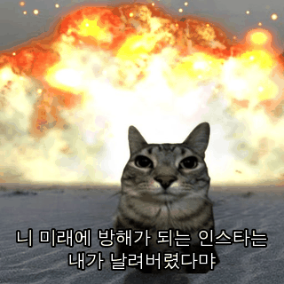
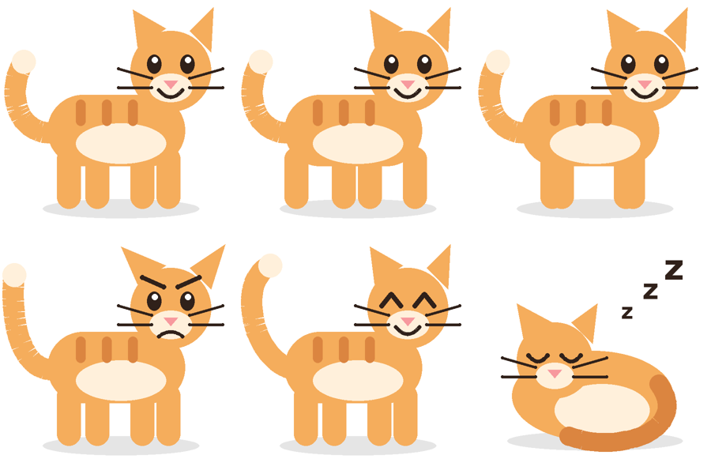

# 인스타 고양이 (InstaCat) — iOS

인스타그램을 정해진 시간(기본 5분) 넘게 보면 고양이가 나타나 앱을 잠가버리는 아이폰 앱입니다.



인스타를 열면 이 화면이 뜹니다. 불은 실제로 끓어오르며 타오릅니다.



감시 중일 때 앱 안을 돌아다니는 고양이 — 이미지 파일 없이 `CatArt.swift` 가 코드로 그립니다.
(위 미리보기는 같은 좌표를 파이썬으로 포팅해 렌더링한 것입니다.)

---

## 먼저, 아이폰에서 되는 것과 안 되는 것

원래 요청은 "고양이가 핸드폰 위를 돌아다니다가 인스타 5분 넘기면 꺼버리기" 였는데,
iOS 는 안드로이드와 달리 **다른 앱 위에 무언가를 그리는 것(오버레이)을 OS 차원에서 금지**합니다.
그래서 아래처럼 나눠서 만들었습니다.

| 원했던 것 | iOS 에서 | 이 앱의 방식 |
|---|---|---|
| 인스타 위를 걸어다니는 고양이 | ❌ 불가능 | — |
| 인스타 5분 넘기면 못 보게 막기 | ✅ 가능 | 스크린 타임(FamilyControls)으로 앱 잠금 |
| 막을 때 고양이가 등장 | ✅ 가능 | 잠금 화면(Shield)을 고양이 그림으로 교체 |
| 고양이가 돌아다니는 모습 | 🟡 일부 | 앱 안에서는 자유롭게, 홈 화면에서는 위젯 안에서 |
| 잠금 화면에서 불이 움직이기 | 🟡 일부 | **잠금 화면은 정지 이미지만 가능.** 열 때마다 폭발 프레임이 한 칸씩 넘어갑니다 |
| 화면 자체를 끄기 | ❌ 불가능 | 앱 잠금까지가 iOS 가 허용하는 최대치 |

> 안드로이드였다면 `SYSTEM_ALERT_WINDOW` + 접근성 서비스로 진짜 오버레이 고양이가 가능합니다.
> 아이폰에서는 이 방식이 유일한 합법적인 길입니다.

---

## 동작 방식

```
사용자가 인스타 사용
        │
        ▼
DeviceActivity 가 사용 시간 합산 (iOS 가 대신 세어 줌)
        │  5분 도달
        ▼
DeviceActivityMonitor 확장이 백그라운드에서 깨어남
        │
        ├─ ManagedSettingsStore 로 인스타에 shield 적용  → 인스타가 안 열림
        └─ 15분(쿨다운) 뒤에 깨어날 스케줄 예약
                                │
                                ▼
                        shield 해제 + 사용 시간 카운터 리셋
```

인스타를 열면 앱 대신 `ShieldConfigurationExtension` 이 그린 폭발 고양이 화면이 뜹니다.
문구는 **"니 미래에 방해가 되는 인스타는 / 내가 날려버렸다먀"**.
버튼은 두 개 — **알겠다먀(닫기)** 와 **한 번 더 터뜨리기 🔥**(잠금은 안 풀리고 다음 폭발 프레임으로 넘어감).

### 불은 어떻게 움직이나

| 어디 | 움직임 |
|---|---|
| 앱 안 (`ExplosionCatView`) | 16프레임 루프를 초당 약 11장으로 재생 — 완전히 부드러움 |
| 잠금 화면 (Shield) | **정지 이미지만 가능.** 화면이 다시 그려질 때마다(인스타를 열 때마다, "한 번 더 터뜨리기" 를 누를 때마다) 다음 프레임 |
| 위젯 | 잠금 중이면 폭발 고양이로 바뀜. 위젯 갱신 주기가 길어서 아주 천천히 |
| `preview-explosion.gif` | 어디에나 붙여 쓸 수 있는 공유용 짤 (카톡 등) |

프레임은 원본 사진 위에 새 폭발을 덧그리는 게 아니라, **이미 타고 있는 영역을 움직이는 난류로 일렁이게**
만들고 그 위에 불티와 불꽃 혀를 얹는 방식입니다. 모든 시간 항의 주기를 프레임 수에 맞춰
루프가 끊기지 않습니다. `tools/make_frames.py` 를 보세요.

## 파일 구조

```
insta_cat_ios/
├── project.yml                   XcodeGen 설정 (타깃 5개, Info.plist·entitlements 자동 생성)
├── Sources/
│   ├── Shared/                   네 타깃이 함께 쓰는 코드
│   │   ├── AppGroup.swift         App Group 기반 공유 설정/상태
│   │   ├── ActivityNames.swift    DeviceActivity 이름과 스케줄
│   │   ├── CatArt.swift           걸어다니는 고양이를 Core Graphics 로 직접 그림
│   │   └── ExplosionCat.swift     폭발 짤 프레임 로딩과 대사
│   ├── App/                      본체 앱
│   │   ├── InstaCatApp.swift
│   │   ├── ContentView.swift      권한 · 앱 선택 · 규칙 설정 화면
│   │   ├── CatStage.swift         걸어다니는 고양이 + 폭발 애니메이션 뷰
│   │   └── ScreenTimeModel.swift  권한 요청, 감시 시작/중지
│   ├── Monitor/                  백그라운드 감시 확장 (시간 초과 감지 → 잠금)
│   ├── Shield/                   잠금 화면 디자인 (폭발 고양이 등장)
│   ├── ShieldAction/             잠금 화면 버튼 처리
│   └── Widget/                   홈 화면 위젯
├── Resources/Explosion/          폭발 애니메이션 16프레임 (앱·잠금화면·위젯 번들에 포함)
├── preview-explosion.gif         공유용 애니메이션 짤
└── tools/
    ├── source_cat.jpg            원본 짤
    ├── make_frames.py            프레임 생성 (numpy + Pillow)
    └── make_gif.py               GIF 생성
```

`Sources/Shared/ExplosionCat.swift` 가 프레임 로딩과 대사를 들고 있습니다.

### 짤을 다른 걸로 바꾸고 싶으면

```bash
pip install numpy pillow
cd insta_cat_ios
# tools/source_cat.jpg 를 원하는 사진으로 교체한 뒤
python3 tools/make_frames.py Resources/Explosion
python3 tools/make_gif.py Resources/Explosion preview-explosion.gif
```

`make_frames.py` 위쪽의 `BOOM`(불덩이 중심)과 `CAT_C` / `CAT_R`(고양이 위치·크기)을
새 사진에 맞게 조정하면 됩니다. 대사는 `ExplosionCat.taunt` 와 `make_gif.py` 의 `LINES` 에 있습니다.

> `tools/source_cat.jpg` 는 사용자가 직접 넣은 짤입니다. 본인 폰에 넣어 쓰는 건 문제없지만
> 앱을 배포할 계획이라면 출처가 분명한 이미지로 바꾸세요.

---

## 빌드 방법

**필요한 것**: macOS + Xcode 15 이상, iOS 16 이상 실기기(시뮬레이터에서는 스크린 타임 API 가 제대로 안 돕니다), Apple ID.

FamilyControls 는 **개발용(Development) 으로는 무료 Apple ID 로도 바로 쓸 수 있습니다.**
App Store 배포용 entitlement 만 애플에 따로 신청해야 합니다. 본인 폰에 넣어서 쓰는 건 신청 없이 가능합니다.

```bash
brew install xcodegen          # 처음 한 번만
cd insta_cat_ios
xcodegen generate              # InstaCat.xcodeproj 생성
open InstaCat.xcodeproj
```

Xcode 에서:

1. 5개 타깃(`InstaCat`, `InstaCatMonitor`, `InstaCatShield`, `InstaCatShieldAction`, `InstaCatWidget`) 각각에서
   **Signing & Capabilities → Team** 을 본인 계정으로 지정합니다.
2. 번들 ID 는 `com.example.*` 라 그대로는 서명이 안 됩니다. 다섯 개를 본인 도메인으로 바꾸세요.
   (`project.yml` 의 `PRODUCT_BUNDLE_IDENTIFIER` 를 고치고 `xcodegen generate` 를 다시 돌리는 게 편합니다.
   앱 = `com.내이름.InstaCat`, 확장 = `com.내이름.InstaCat.Monitor` 처럼 **확장은 반드시 앱 번들 ID 로 시작**해야 합니다.)
3. App Group `group.com.example.instacat` 도 본인 것으로 바꾼다면
   `project.yml` 과 `Sources/Shared/AppGroup.swift` 의 `identifier` 를 **똑같이** 맞춰야 합니다.
   안 맞으면 잠금은 걸리는데 화면에 고양이가 안 나오거나 설정이 안 읽힙니다.
4. 각 타깃에 **Family Controls** capability 가 붙어 있는지 확인합니다 (entitlements 로 이미 들어가 있습니다).
5. 실기기에 빌드 → 실행.

## 처음 실행 후

1. **권한 허용하기** → 스크린 타임 권한 팝업에서 허용
2. **인스타그램 고르기** → 시스템 앱 목록에서 Instagram 선택
   (애플이 앱 목록을 가려놔서 코드로 미리 지정할 수 없고, 반드시 사용자가 직접 골라야 합니다)
3. 제한 시간(기본 5분)과 쿨다운(기본 15분)을 정하고 **고양이 풀어놓기**

---

## 알려진 제약

- **정확한 스톱워치가 아닙니다.** iOS 가 사용 시간을 알려주는 시점에 반응하기 때문에 1~2분 정도 늦게 잠길 수 있습니다.
- **쿨다운은 15분 미만으로 못 잡습니다.** `DeviceActivitySchedule` 의 최소 창 길이가 15분입니다.
- **"5분"은 세션이 아니라 감시 창 기준 누적입니다.** 잠금이 풀릴 때마다 카운터를 0으로 되돌리기 때문에
  실사용상 "한 번에 5분"에 가깝게 동작하지만, 잠금 사이사이 짧게 여러 번 본 시간도 합산됩니다.
- **앱을 지우면 잠금도 풀립니다.** 의지를 대신해 주지는 못합니다.
- **잠금 화면의 불은 부드럽게 움직이지 않습니다.** `ShieldConfiguration.icon` 이 `UIImage` 한 장이라
  동영상도 GIF 도 못 넣습니다. 대신 열 때마다 다른 프레임이 나옵니다.
- 이 코드는 리눅스 환경에서 작성돼 **컴파일 검증을 하지 못했습니다.** Xcode 에서 처음 열 때 자잘한 수정이 필요할 수 있습니다.

---

## 맥이 없다면 — 오늘 당장 되는 무료 대안

Xcode 없이 아이폰만으로 비슷한 걸 만들 수 있습니다. 고양이는 없지만요.

**A. 스크린 타임 앱 시간 제한 (가장 간단)**
설정 › 스크린 타임 › 앱 시간 제한 › 소셜 › Instagram → 5분.
단, **하루 총합** 기준이라 한 번 쓰면 그날은 끝입니다.

**B. 단축어 자동화 (세션마다 5분)**
단축어 앱 › 자동화 › 새 자동화 › **앱** › Instagram › **열렸을 때** › 즉시 실행(묻지 않기)
→ 동작: **대기 300초** → **화면 잠그기**

인스타를 열고 5분이 지나면 화면이 잠깁니다. 중간에 인스타를 나가도 타이머가 계속 도는 점,
백그라운드에서 대기가 중간에 끊길 수 있는 점이 단점입니다. 그래도 설치 없이 5분이면 세팅됩니다.
